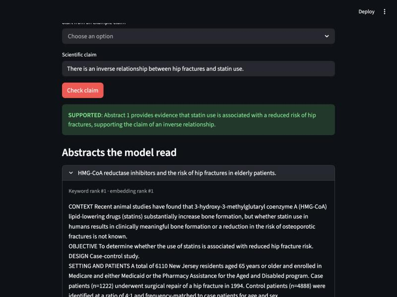
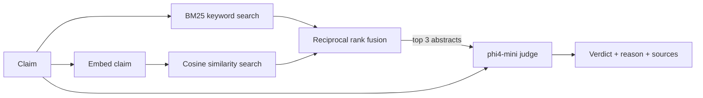

# ClaimCheck

A retrieval-augmented fact-checker for scientific claims. Type a claim; it
finds the most relevant of 5,183 paper abstracts and a language model decides
whether they **support** it, **refute** it, or **don't settle it**, with a
reason and the abstracts it read.

Everything runs on a laptop: retrieval is plain Python and NumPy, and the
models run locally through [Ollama](https://ollama.com). No API keys.



## Results

All numbers are measured on the 300 expert-labelled claims of the
[SciFact](https://github.com/allenai/scifact) dev set and can be reproduced
with the commands below.

### Does retrieval find the right papers?

A retrieved abstract counts as correct if the claim cites it.

| Retriever | nDCG@10 | Recall@3 | Recall@10 |
|---|---|---|---|
| BM25, written from scratch | 0.662 | 0.681 | 0.784 |
| Dense (`nomic-embed-text`) | 0.703 | 0.709 | **0.844** |
| Hybrid (reciprocal rank fusion) | **0.706** | **0.710** | 0.823 |

- The [BEIR benchmark](https://arxiv.org/abs/2104.08663) reports 0.665 nDCG@10
  for BM25 on this same claim set. The from-scratch implementation here reaches
  0.662 with a simpler tokeniser (no stemming or stop-word removal).
- Fusion helps only marginally here: the dense retriever is already stronger
  than BM25, and fusing them trades a little recall@10 for a little precision
  at the top.

## How it works



| File | What it does |
|---|---|
| `claimcheck/bm25.py` | Tokeniser, inverted index and BM25 scoring |
| `claimcheck/dense.py` | Embeddings from Ollama; cosine search as one matrix product |
| `claimcheck/fusion.py` | Reciprocal rank fusion |
| `claimcheck/retrieve.py` | The three retrievers over one corpus |
| `claimcheck/judge.py` | Prompt, JSON-constrained model call, verdict parsing |
| `claimcheck/metrics.py` | nDCG, recall, accuracy, macro-F1 |
| `claimcheck/eval_retrieval.py`, `eval_verdicts.py` | The two experiments above |
| `app.py` | Streamlit interface |

## Run it

Requires Python 3.10+ and [Ollama](https://ollama.com). Run every command from
the repository root.

```bash
pip install -r requirements.txt
ollama pull phi4-mini
ollama pull nomic-embed-text

python -m claimcheck.download        # SciFact, 3 MB
python -m claimcheck.build_index     # embeds 5,183 abstracts; ~5 min on an M1
streamlit run app.py
```

Reproduce the results and run the tests:

```bash
python -m claimcheck.eval_retrieval  # a few seconds
python -m claimcheck.eval_verdicts   # about 75 min on an M1 with 8 GB; resumable
python -m pytest
```

## Design decisions

- **BM25 from scratch.** It is about 40 lines and matching a published
  baseline shows it is correct, which a library call would not.
- **No vector database.** 5,183 vectors of 768 numbers are 16 MB. Exact search
  is a single matrix-vector product and takes milliseconds; an approximate
  index would add a dependency to solve a problem this corpus does not have.
- **Rank fusion instead of score mixing.** BM25 scores and cosine similarities
  are on different scales. Fusing ranks needs no tuning on the evaluation set.
- **Reason before verdict.** The model's reply is constrained to a JSON schema
  whose first field is the reason, so it reads the evidence before committing.
- **An oracle condition.** Giving the model the cited abstracts shows how much
  error is left when retrieval is perfect, separating search mistakes from
  reasoning mistakes.

## Data and credits

SciFact: Wadden et al., *Fact or Fiction: Verifying Scientific Claims*, EMNLP
2020. Claims and annotations are CC BY 4.0; abstracts come from the Semantic
Scholar S2ORC corpus under ODC-By 1.0. The dataset is downloaded by a script
and is not included in this repository.
